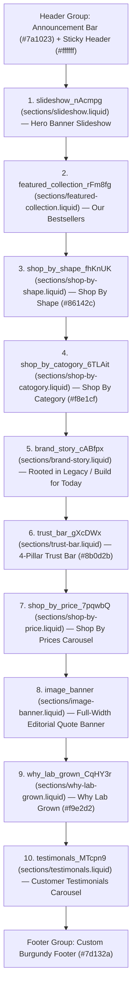

# Mangal Royal Studio — Complete Website Page Structure

This document maps every page template, layout wrapper, section group, section order, and block hierarchy discovered in `jewellery-theme-backup/`.

---

## 1. Global Layouts (`layout/`)

### 1.1 `layout/theme.liquid` (Primary Storefront Layout)
Used by almost all storefront templates (`index`, `product`, `collection`, `list-collections`, `cart`, `page`, `page.about-us`, `page.contact`, `blog`, `article`, `search`, `404`, and `customers/*`).

**DOM Hierarchy:**
1. `<head>`:
   - Meta charset, viewport (`width=device-width,initial-scale=1`), canonical URL, favicon (`settings.favicon`).
   - Preconnect to `https://cdn.shopify.com` and `https://fonts.shopifycdn.com`.
   - Title tag + meta description + `snippets/meta-tags.liquid` (OpenGraph & Twitter Cards).
   - Global scripts: `assets/constants.js`, `assets/pubsub.js`, `assets/global.js`, `assets/details-disclosure.js`, `assets/details-modal.js`, `assets/search-form.js`, `assets/animations.js` (when scroll animations enabled), and `assets/standard-actions-override.js` (`type="module"`).
   - `{{ content_for_header }}` (Shopify analytics, StandardEvents, Trekkie).
   - Inline `@font-face` declarations for `settings.type_body_font` (`Poppins` 400/700) and `settings.type_header_font` (`Poppins` 400) + root CSS variables (`--font-*`, `--color-*`, `--page-width: 120rem` = `1200px`).
   - Stylesheets: `assets/base.css`, `assets/component-cart-items.css`, `assets/component-predictive-search.css`.
2. `<body class="gradient">`:
   - Accessibility skip link (`<a class="skip-to-content-link button visually-hidden" href="#MainContent">`).
   - Conditional Cart Drawer: `` (Note: `settings_data.json` currently sets `cart_type: "notification"`, so `cart-notification` inside `sections/header.liquid` is active instead).
   - **Header Group:** ``
     1. `sections/announcement-bar.liquid`
     2. `sections/header.liquid` (includes `<mrs-header-drawer>`, `<details-modal class="header__search">`, and ``)
   - **Main Content:** `<main id="MainContent" class="content-for-layout focus-none" role="main" tabindex="-1">{{ content_for_layout }}</main>`
   - **Footer Group:** ``
     1. `sections/custom-footer.liquid` (`custom_footer_cmNB7q` — active)
     2. `sections/footer.liquid` (`footer` — disabled)
   - Accessibility status region (`#a11y-refresh-page-message`, `#a11y-new-window-message`).
   - Global JS variables: `window.shopUrl`, `window.routes` (`cart_add_url`, `cart_change_url`, `cart_update_url`, `cart_url`, `predictive_search_url`), `window.cartStrings`, `window.variantStrings`, `window.quickOrderListStrings`, `window.accessibilityStrings`.
   - Deferred predictive search script: `assets/predictive-search.js`.

### 1.2 `layout/password.liquid` (Storefront Password Gate Layout)
Used exclusively by `templates/password.json`.
- Renders `sections/main-password-header.liquid`, `<main id="MainContent">{{ content_for_layout }}</main>`, and `sections/main-password-footer.liquid`.

---

## 2. Global Section Groups (`sections/header-group.json` & `sections/footer-group.json`)

### 2.1 Header Group (`sections/header-group.json`)
Rendered at the top of every page in exact order:

| Order | Section ID | Section File | Active Settings & Blocks |
| :---: | :--- | :--- | :--- |
| **1** | `announcement-bar` | `sections/announcement-bar.liquid` | **Settings:** `bg_color: "#7a1023"`, `text_color: "#ffffff"`, `border_color: "#7a1023"`, `border_thickness: 2`, `bar_height_desktop: 34`, `bar_height_mobile: 32`, `font_size_desktop: 12`, `font_size_mobile: 10`, `font_weight: "400"`, `letter_spacing: 0.4`, `auto_rotate: false`. **Block 1 (`announcement_bRVMJU`):** `text: "Get 10% OFF On Engagement Rings"`, `link: ""`. |
| **2** | `header` | `sections/header.liquid` | **Settings:** `logo_position: "middle-left"`, `mobile_logo_position: "center"`, `menu: "main-menu"`, `menu_type_desktop: "dropdown"`, `sticky_header_type: "always"`, `header_bg_color: "#ffffff"`, `header_border_color: "#eeeeee"`, `header_text_color: "#190303"`, `header_hover_color: "#7a1023"`, `header_height_desktop: 62`, `header_height_mobile: 62`, `header_padding_x_desktop: 40`, `header_padding_x_mobile: 12`, `nav_font_size: 12`, `nav_font_weight: "400"`, `nav_letter_spacing: 0.6`, `nav_gap: 32`, `nav_uppercase: true`, `show_wishlist: true`, `wishlist_link: "/pages/wishlist"`. **Logo (from `settings_data.json`):** `shopify://shop_images/Group_1000004348.png`, `logo_width: 110` (desktop), `130px` max on mobile. |

### 2.2 Footer Group (`sections/footer-group.json`)
Rendered at the bottom of every page in exact order:

| Order | Section ID | Section File | Active Settings & Structure |
| :---: | :--- | :--- | :--- |
| **1** | `custom_footer_cmNB7q` | `sections/custom-footer.liquid` | **Colors & Layout:** `bg_color: "#7d132a"`, `text_color: "#ffffff"`, `muted_text_color: "#f2d8df"`, `divider_color: "#a53850"`, `max_width: 1440`, `padding_top_desktop: 56`, `padding_bottom_desktop: 24`, `padding_x_desktop: 60`, `padding_top_mobile: 40`, `padding_bottom_mobile: 24`, `padding_x_mobile: 22`, `column_gap_desktop: 40`. **Top Newsletter Bar:** `show_newsletter: true`, `newsletter_heading: "Join the mailing list"` (`45px` desktop / `30px` mobile, Begum serif), `newsletter_placeholder: "Your email address"`, `newsletter_button_text: "Subscribe"`, `newsletter_form_width: 440`, `newsletter_input_height: 60` (`50px` mobile), `newsletter_btn_bg: "#ffffff"`, `newsletter_btn_text_color: "#1c1c1c"`. **Main 5-Column Grid (`1.1fr 0.8fr 1fr 1fr 0.7fr`):** • **Col 1 (Brand):** Logo `shopify://shop_images/6b6217cf80a12befaeed66e6688a7640fc7d7c82.png` (`120px` width) + description `"Designed for every day. Treasured for a lifetime. A unit of Mangal Royal Jewels Pvt Ltd — since 1975."` (`14px` Gotham, `max-width: 220px`). • **Col 2 (Menu 1):** Heading `"Menu"`, linklist `"quick-links"`. • **Col 3 (Menu 2):** Heading `"Jewellery"`, linklist `"collections"`. • **Col 4 (Menu 3):** Heading `"Policies"`, linklist `"servies"`. • **Col 5 (Social):** `social_style: "both"`, Instagram (`https://www.instagram.com/`), Facebook (`https://www.instagram.com/`), LinkedIn (enabled, empty URL). • **Mobile Behaviour (`<=767px`):** Menus collapse into accordions (`[data-mrs-accordion-toggle]`) with rotating chevron icons. • **Bottom Bar:** Centered copyright `"© 2026, All rights reserved by Mangal Royal Studio"` (`12px`). |
| **2** | `footer` | `sections/footer.liquid` | `"disabled": true` (Standard Dawn footer is disabled). |

---

## 3. Homepage Section Order (`templates/index.json`)

The homepage consists of **10 active sections** in the exact order below:

### Detailed Homepage Section Specifications

| # | Section ID & Type | Section File | Layout & Visual Details | Blocks & Content |
| :-: | :--- | :--- | :--- | :--- |
| **1** | `slideshow_nAcmpg` (`slideshow`) | `sections/slideshow.liquid` | Full-bleed (`full_width: true`), height `610px` desktop / `600px` tablet / `400px` mobile. Circular prev/next arrow buttons (`64px` desktop / `48px` mobile) at bottom-right (`right: 54px; bottom: 38px`). Autoplay disabled. | **Block 1 (`slide_RE9X4N`):** Image `2cad1ff177013aa3114de81b745559fa80ff958a.jpg`, overlay `30%`, left-aligned (`max-width: 560px`). Eyebrow: `"TRADITION IN TRUST"` (`34px` Begum, `#fff`), Heading: `"Brilliance For Today"` (`64px` Battlemade cursive, `#fff`), Description: `"Every creation is designed to reflect modern elegance while carrying forward a legacy of trust."` (`14px` Gotham, `#ebebeb`), CTA: `"Shop Now"` (`/collections/all`) with diagonal arrow & expanding underline. **Block 2 (`slide_mwwjMg`):** Placeholder slide (`TRADITION IN TRUST` / `Brilliance For Today`, no image). |
| **2** | `featured_collection_rFm8fg` (`featured-collection`) | `sections/featured-collection.liquid` | Bg `#ffffff`, container `1440px`, padding `70px` top/bottom, `70px` sides desktop (`44px`/`16px` mobile). Desktop layout: `carousel` (`4` cols, `36px` gap, `<pc-carousel>` with circular side arrows); Tablet: `3` cols; Mobile: `grid` (`2` cols, `14px` gap). | **Header:** Eyebrow `"The most loved"` (`64px` desktop / `36px` mobile Battlemade, `#7d132a`), Heading `"Our Bestsellers"` (`45px` desktop / `28px` mobile Begum uppercase, `#190303`). **Collection:** `"best-sellers"`, `products_to_show: 8`. Renders `snippets/card-product.liquid` (`image_ratio: "portrait"` `285/397`, `show_hover_image: true`, `show_wishlist: true`, `show_cart: true`, `show_buy_button: true`, `buy_button_text: "Buy Now"`, `buy_bg: "#7d132a"`). **Footer CTA:** `"View All"` link with right arrow (`#190303`). |
| **3** | `shop_by_shape_fhKnUK` (`shop-by-shape`) | `sections/shop-by-shape.liquid` | Bg `#86142c`, text `#ffffff`, hover `#f8d8df`, container `1280px`, padding `56px` top/bottom, `40px` sides (`36px`/`16px` mobile). Desktop: 7-col flex row (`16px` gap); Tablet: horizontal scroll-snap; Mobile: 3-col grid (`24px` gap). | **Header:** Subtitle `"Crafter for you"` (`64px` desktop / `52px` tablet / `34px` mobile Battlemade), Title `"SHOP BY SHAPE"` (`45px`/`38px`/`28px` Begum uppercase). **7 Shape Blocks (`80x80px` icon):** 1. `Round` (`0d3cd5b42c34340dd612c78835ea1c2d3b0adb38.png`, `/collections/round`) 2. `Cushion` (SVG placeholder) 3. `Emerald` (SVG placeholder) 4. `Pear` (SVG placeholder) 5. `Oval` (SVG placeholder) 6. `Princess` (SVG placeholder) 7. `Heart` (SVG placeholder) |
| **4** | `shop_by_catogory_6TLAit` (`shop-by-catogory`) | `sections/shop-by-catogory.liquid` | Bg `#f8e1cf`, container `1280px`, padding `80px 70px 90px 70px` desktop (`50px 16px 60px 16px` mobile). Desktop: 4-col grid (`32px` col gap, `56px` row gap) with **alternating vertical stagger** (`0px` vs `-48px`). Mobile: swipe carousel (`83.333%` card width, `16px` gap). | **Header:** Script `"Discover collections"` (`64px`/`50px`/`34px` Battlemade, `#7d132a`), Heading `"Shop by category"` (`45px`/`38px`/`28px` Begum uppercase, `#190303`). **7 Category Blocks (`410px` image height desktop / `300px` mobile):** 1. `Rings` (`7d83bf726259819272b0f6c542fa03a7d0d65025.png`, offset `0px`) 2. `Bracelets` (`4aa92d916448df116c23b56c699ebfd6e343cf83.jpg`, offset `-48px`) 3. `Earrings` (`c4fa0f8f347290ae8527157b7eb38a66611c8a98.jpg`, offset `0px`) 4. `Bangles` (`9888b4340c0daaf63638652dd17a78e59d8d37bb.jpg`, offset `-48px`) 5. `Pendants` (`3e0daaf9fa4ef07c2e542a7bf2eb27c5cd06e1bb.jpg`, offset `0px`) 6. `Necklaces` (`5dc6a5f06299d80025a3d4945ab1bece52931e36.png`, offset `-48px`) 7. `Antique` (`2859edef8aa975cb5c3eb444462c985be61a24e4.jpg`, offset `0px`) |
| **5** | `brand_story_cABfpx` (`brand-story`) | `sections/brand-story.liquid` | Bg `#ffffff`, container `1320px`, padding `110px 40px` desktop (`60px 16px` mobile). 2-col layout (`42%` content / `58%` collage, `64px` gap). Scroll fade-left/right/up animations. | **Left Content:** Small heading `"ROOTED IN LEGACY"` (`58px`/`46px`/`30px` Begum uppercase, `#190303`), Main heading `"Build for today."` (`114px`/`96px`/`58px` Battlemade cursive, `#7d132a`, `-24px` top margin overlap), Description (`16px` Gotham, `#3e3e3e`). **Right 3-Image Collage (`12px` gap):** • Top wide (`172px` h desktop / `200px` mobile): `e19be3172053d7c0b01e8875a7d6bf100fb571df.png` • Bottom-left (`262x273px`): `7639a76a07625bb79914ba2544f4d8b35e74aa11.png` • Bottom-right (`flex:1`, `273px` h): `b890046a036c6e4eb1b538dc0791871d26e4596f.png` |
| **6** | `trust_bar_gXcDWx` (`trust-bar`) | `sections/trust-bar.liquid` | Bg `#8b0d2b`, text/icon `#ffffff`, height `84px` desktop / `78px` mobile, container `1300px`. Desktop: 4-col grid (`32px` gap); Tablet: 2-col grid; Mobile: infinite CSS marquee (`22s` speed, `88vw` item width). | **4 Trust Blocks (`48x48px` stroke SVGs):** 1. `IGI Certified` — *"Every diamond certified for authenticity"* 2. `Lifetime Exchange` — *"Full value on every piece, forever"* 3. `Free Shipping` — *"Insured delivery across India"* 4. `Free Resizing` — *"Complimentary for 30 days after purchase"* |
| **7** | `shop_by_price_7pqwbQ` (`shop-by-price`) | `sections/shop-by-price.liquid` | Bg `#ffffff`, container `1440px`, padding `50px 70px 90px 70px` desktop (`45px 16px 55px 16px` mobile). Infinite loop + drag carousel on desktop & mobile (`285px` card width, `37px` gap desktop / `14px` mobile, `2.5` cards visible on mobile + dots). | **Header:** Eyebrow `"In your budget"` (`64px`/`54px`/`36px` Battlemade, `#7d132a`), Heading `"Shop by prices"` (`45px`/`38px`/`30px` Begum uppercase, `#190303`). **4 Price Cards (`1:1` image + `28px` `#7d132a` bottom strip):** 1. `"UNDER ₹15K"` (`b7ba10190c510a268db40d1e9a87a774b73deac9.png`) 2. `"₹15K TO ₹25K"` (`cf4460ad799a545b7fa760e490ba843ed33bc589.png`) 3. `"₹25K TO ₹50K"` (`b7ba10190c510a268db40d1e9a87a774b73deac9.png`) 4. `"₹50K AND ABOVE"` (`cf4460ad799a545b7fa760e490ba843ed33bc589.png`) |
| **8** | `image_banner` (`image-banner`) | `sections/image-banner.liquid` | Standard Dawn banner, `image_height: "medium"`, `image_overlay_opacity: 40`, `color_scheme: "scheme-3"` (white text on dark), centered content without container box. | **Image:** `59205e0bf94ef6a4257d713defef8fe89d9fe5b8.png` **Heading Block (`heading`):** `"\"Luxury today is not just about what you wear. It's about the choices you make.\""` (`h0`). |
| **9** | `why_lab_grown_CqHY3r` (`why-lab-grown`) | `sections/why-lab-grown.liquid` | Bg `#f9e2d2`, container `1440px`, padding `90px 70px` desktop (`50px 16px 55px 16px` mobile). 50%/50% 2-column split (`56px` inner left padding on content column). | **Left Image:** `32830c2dc27609f18b884bc5ab307d57f0f8f900.png` (`795px` height desktop / `420px` mobile, `14px` mobile radius). **Right Content:** Eyebrow `"The conscious choice"` (`64px`/`54px`/`34px` Battlemade, `#7d132a`), Heading `"Why lab grown?"` (`45px`/`38px`/`30px` Begum uppercase, `#190303`), 3 Feature Blocks (`flower`: `"Physically identical"`, `leaf`: `"Consciously made"`, `gem`: `"Exceptional value"`), and `"Shop now"` button (`#7d132a`, `48px` height). |
| **10** | `testimonals_MTcpn9` (`testimonals`) | `sections/testimonals.liquid` | Bg `#ffffff`, container `1300px`, padding `70px 0 70px 32px` desktop (`45px 16px 55px 16px` mobile). Carousel showing ~`2.15` cards (`576px` card width at `>=1300px`, `32px` gap, `40px` card padding, `1px solid #e2e2e2` border), 5s autoplay + swipe. | **Header Row:** Left-aligned Subheading `"Loved by families"` (`38px`/`28px` Great Vibes, `#8f1028`) + Heading `"WHAT OUR CUSTOMERS SAY"` (`45px`/`36px`/`30px` Begum, `#190303`); Right-aligned circular Prev (`#fff` bg) & Next (`#7d132a` bg) buttons. **4 Testimonial Blocks:** 5 stars (`#8d0f2b`), review text (`18px` Gotham), author `"Jay Veer"`, role `"Customer"`. |

---

## 4. Product Detail Page (`templates/product.json`)

The Product Detail Page (PDP) renders **5 active sections** (and 1 disabled section) in the exact order below:

| Order | Section ID | Section File | Status | Structure & Behaviour |
| :---: | :--- | :--- | :---: | :--- |
| **1** | `main` | `sections/main-product.liquid` | **Active** | **Custom Premium Product Page (`#premium-product-*`):** • **Container:** `1280px` max-width, `36px` side padding desktop (`16px` mobile). • **Breadcrumb:** `HOME › [First Collection] › [Product Title]` (`9px` uppercase DM Sans). • **Left Column (55% width):** 4-media editorial collage (`8px` gap): Media 1 is full-width square hero (`.pp-media--hero`, `1/1`); Media 2 is left-column tall image spanning 2 rows (`.pp-media--tall`); Media 3 & 4 are right-column landscape images (`.pp-media--small`, `4/3`). Clicking any image opens a full-screen lightbox (`data-lightbox`). • **Right Column (45% width, sticky `top: 20px`):**   - Product Title (`34px` desktop / `28px` mobile Cormorant Garamond Semi-Bold `#2D2021`).   - Star Rating (`★★★★★ 5 (1.2k Reviews)` fallback, `#E39A16` stars).   - Price Row: Current variant price (`15px` DM Sans Semi-Bold `#8E1230`) + Compare-at price (`12px` strikethrough `#aaa`).   - Variant Options: First option (when >1 option) renders as circular shape buttons (`.pp-shape`, `30px` circle); remaining options render as `<select class="pp-select">` (`34px` height desktop / `40px` mobile).   - Actions Row (`60px 1fr 44px` grid, `40px` height): Quantity selector (`-`, input, `+`), `"ADD TO CART"` button (`#8E1230` bg), and Wishlist heart button (`#fff` bg, `#E6E0DE` border).   - Secondary Action: Full-width outlined `"BUY NOW"` button (`38px` height, `#8E1230` border & text) that adds to cart and redirects to `/checkout`.   - **2x2 Details Meta Grid (`.pp-meta-grid`):** `Gold` (`product.metafields.custom.gold`), `Diamonds` (`product.metafields.custom.diamonds`), `Categories` (`product.metafields.custom.categories` or `product.type`), `SKU` (`current_variant.sku`).   - **Shipping Row:** Checkmark circle icon + `"Free shipping on all orders."`   - **4 Accordions (`
`):** `Descriptions` (open by default), `Care instructions`, `Shipping`, `Returns & cancellations`. |
| **2** | `disclosures` | `sections/disclosures.liquid` | **Active** (Conditional) | Renders `snippets/product-disclosures.liquid` only if `product.metafields.shopify.disclosure.value` is present. Closed by default. |
| **3** | `related-products` | `sections/related-products.liquid` | **Disabled** | `"disabled": true` in `templates/product.json`. |
| **4** | `trust_bar_XR7Mea` | `sections/trust-bar.liquid` | **Active** | Same 4-item burgundy (`#8b0d2b`) Trust Bar as homepage (`IGI Certified`, `Lifetime Exchange`, `Free Shipping`, `Free Resizing`). |
| **5** | `featured_collection_jeXppT` | `sections/featured-collection.liquid` | **Active** | `"The most loved"` / `"Our Bestsellers"` 4-column product carousel (8 products from `best-sellers`). |
| **6** | `mangal_physical_store_cta_qXGRbj` | `sections/mangal-physical-store-cta.liquid` | **Active** | Peach (`#FBE8DB`) banner with `#E7D1C4` top/bottom borders (`1160px` inner width): Left copy `"Loved it online? Now you can find it in our physical store."` (`28px` Cormorant Garamond) + `"visit our store !"` (`42px` Allura script); Right button `"GET STORE LOCATION"` (`#8E1230` bg, `150x34px`). |

---

## 5. About Us Page (`templates/page.about-us.json`)

The About Us page disables the default page title/content section and renders **6 bespoke editorial sections** in the exact order below:

| Order | Section ID | Section File | Status | Structure & Visual Details |
| :---: | :--- | :--- | :---: | :--- |
| **1** | `main` | `sections/main-page.liquid` | **Disabled** | `"disabled": true` |
| **2** | `heritage_modern_editorial_AMUwqw` | `sections/heritage-modern-editorial.liquid` | **Active** | **Hero Split (47% text / 53% image, `#ffffff` bg, `1320px` max-width):** • Left: Eyebrow `"We believe in blend"` (`22px` Allura, `#a33b56`), Heading `"WHERE HERITAGE MEETS\nTHE MODERN DIAMOND."` (`34px` Cormorant Garamond, `#2f2325`), Body paragraph, Highlighted Belief `"Mangal Royal Studio was created from a simple belief: fine jewellery should honour tradition while embracing the future."`, and Button `"EXPLORE OUR COLLECTION"` (`#8e1732` bg, `156x32px`). • Right: Portrait editorial image (`aspect-ratio: 1.03`). |
| **3** | `legacy_jewellery_editorial_GmxRyY` | `sections/legacy-jewellery-editorial.liquid` | **Active** | **Overlapping Collage & Story (`#f7e0d0` bg, `1320px` max-width, 50%/50% split):** • Left: `520x575px` desktop stage (`420px` mobile stage) with `back_image` (`390x290px` at `0,0`) and `front_image` (`390x300px` at `top: 275px, left: 130px`, `z-index: 2`). • Right: Eyebrow `"The conscious choice"` (`23px` Allura, `#9e2e49`), Heading `"A LEGACY\nJEWELLERY HOUSE\nREIMAGINED FOR TODAY."` (`32px` Cormorant Garamond), 3 paragraphs detailing the 1975 founding of Mangal Royal Jewels Pvt Ltd, and italic quote `"\"The future of luxury is responsible, transparent, and accessible — without losing its soul.\""`. |
| **4** | `content_prKXpp` | `sections/content.liquid` | **Active** | **Our Core Values (`#7d132a` bg, `#fff8f5` text, `1360px` max-width):** • Header: Eyebrow `"What we stand for"` (`28px` Allura), Heading `"OUR CORE VALUES"` (`32px` Cormorant Garamond). • Desktop: 4-column grid (`34px` gap) with `1px solid #b88996` left border and `22px` left padding per item (`Legacy & Trust`, `Modern Luxury`, `Conscious Brilliance`, `Emotional Storytelling`). • Mobile (`<=749px`): Interactive single-card slider with Prev/Next arrow buttons + `<select>` dropdown (`mobile_navigation: "arrows_select"`) and touch swipe. |
| **5** | `visionaries_editorial_collage_fixed_fTN77p` | `sections/visionaries-editorial-collage-fixed.liquid` | **Active** | **Brand Promise 5-Image Collage (`#8d102c` band bg, `#ffffff` text, `1200px` max-width):** • Left: `480x500px` absolute-positioned 5-image collage stage on desktop (2-column grid + full-width 5th image on mobile). • Right: Heading `"BRAND PROMISE"` (`34px` Cormorant Garamond), Script `"Every piece. Every detail. Every time."` (`32px` Allura), 2 paragraphs of promise copy, and white CTA button `"EXPLORE OUR COLLECTIONS"` (`#ffffff` bg, `#2f1d21` text). |
| **6** | `mangal_group_legacy_MrPKU7` | `sections/mangal-group-legacy.liquid` | **Active** | **The Mangal Group (`#FFFFFF` bg, `1px solid #8D102C` top border, `1160px` max-width):** • Header: Eyebrow `"The Mangal Group"` (`28px` Allura, `#A02D4A`), Heading `"A LEGACY THAT EXTENDS BEYOND JEWELLERY"` (`28px` Cormorant Garamond, `#302326`). • Grid: 3x2 desktop grid (2 cols tablet, 1 col mobile, `18px` gap) of 6 bordered cards (`1px solid #D99AAA`, `8px` radius, `170px` min-height, `#A51F43` icons):   1. `Mangal Royal Studio` (`diamond` icon)   2. `Mangal Credit and Fincorp Ltd` (`bank` icon)   3. `Mangal Finserv Pvt Ltd` (`finance` icon)   4. `Mangal BuildHome Pvt Ltd` (`building` icon)   5. `Mangal Entertainment Pvt Ltd` (`theatre` icon)   6. `Mangal Charitable Trust` (`heart` icon) |
| **7** | `mangal_forever_piece_cta_wtwKF9` | `sections/mangal-forever-piece-cta.liquid` | **Active** | **Forever Piece CTA (`#FBE8DB` bg, `1000px` max-width, centered):** • Heading `"Ready to find your forever piece?"` (`28px` Cormorant Garamond, `#302326`), Description (`12px` DM Sans, `#5F5555`). • 2 Action Buttons (`135x34px` min): Primary `"SHOP COLLECTIONS"` (`#170A09` bg, `#FFFFFF` text) and Secondary `"GET AT HOME SERVICE"` (`#FBE8DB` bg, `#514343` text, `1px solid #8B7770` border). |

---

## 6. Collection, Cart, Search & Other Storefront Templates

| Template File | Route Pattern | Section Order & Configuration |
| :--- | :--- | :--- |
| `templates/collection.json` | `/collections/[handle]` | 1. **`banner` (`sections/main-collection-banner.liquid`):** `show_collection_description: true`, `show_collection_image: false`, `color_scheme: "scheme-1"`. 2. **`product-grid` (`sections/main-collection-product-grid.liquid`):** `products_per_page: 16`, `columns_desktop: 4`, `columns_mobile: "2"`, `enable_filtering: true`, `filter_type: "horizontal"`, `enable_sorting: true`, `quick_add: "none"`. Renders custom `snippets/card-product.liquid` for each product and `snippets/pagination.liquid`. |
| `templates/list-collections.json` | `/collections` | 1. **`main` (`sections/main-list-collections.liquid`):** `title: "Collections"`, `sort: "alphabetical"`, `image_ratio: "square"`, `columns_desktop: 3`, `columns_mobile: "2"`. |
| `templates/cart.json` | `/cart` | 1. **`cart-items` (`sections/main-cart-items.liquid`):** Line item table (media, title, unit price, `<quantity-popover>` `-`/`+` input + `<cart-remove-button>`, line total), empty-cart state with `"Continue shopping"` CTA and customer login prompt. 2. **`cart-footer` (`sections/main-cart-footer.liquid`):** Optional `<cart-note>`, discounts list, `subtotal` block (`Estimated total` in INR + tax/shipping note), `buttons` block (`Checkout` submit button + dynamic checkout buttons). |
| `templates/search.json` | `/search` | 1. **`main` (`sections/main-search.liquid`):** Search input with predictive search, horizontal facets (`enable_filtering: true`, `filter_type: "horizontal"`, `enable_sorting: true`), 4-column desktop / 2-column mobile grid rendering `snippets/card-product.liquid`, plus article/page search results (`article_show_date: true`). |
| `templates/page.contact.json` | `/pages/contact` | 1. **`main` (`sections/main-page.liquid`):** Page title & rich text body (`padding_top: 36`, `padding_bottom: 36`). 2. **`form` (`sections/contact-form.liquid`):** Name, Email (required), Phone number, Comment textarea, and `"Send"` button (`scheme-1`). |
| `templates/page.json` | `/pages/[handle]` | 1. **`main` (`sections/main-page.liquid`):** Standard content page (`padding_top: 28`, `padding_bottom: 28`) used for policy/legal/informational pages. |
| `templates/blog.json` | `/blogs/[handle]` | 1. **`main` (`sections/main-blog.liquid`):** `layout: "collage"`, `show_image: true`, `image_height: "medium"`, `show_date: true`, `show_author: false`. |
| `templates/article.json` | `/blogs/[blog]/[article]` | 1. **`main` (`sections/main-article.liquid`):** Blocks: `featured_image` (`adapt`), `title` (with date, no author), `content`, `share`. |
| `templates/404.json` | `/404` | 1. **`main` (`sections/main-404.liquid`):** 404 subtext, `"Page not found"` heading, `"Continue shopping"` button linking to `/collections/all`. |
| `templates/password.json` | `/password` | Uses `layout/password.liquid`. 1. **`main` (`sections/email-signup-banner.liquid`):** `"Opening soon"` heading + email signup form. |
| `templates/gift_card.liquid` | `/gift_cards/[id]` | Standalone HTML document rendering gift card value, gift card image, QR code (`vendor/qrcode.js`), code copy button, and Apple Wallet pass button. |

---

## 7. Customer Account Templates (`templates/customers/*.json`)

All 7 customer templates use `layout/theme.liquid`:

| Template File | Route | Section File | Key Elements |
| :--- | :--- | :--- | :--- |
| `customers/login.json` | `/account/login` | `sections/main-login.liquid` | Email + Password login form, inline `#recover` password recovery form, `"Create account"` link, and guest checkout button (if applicable). |
| `customers/register.json` | `/account/register` | `sections/main-register.liquid` | First name, Last name, Email, Password registration form. |
| `customers/account.json` | `/account` | `sections/main-account.liquid` | Order history table (Order #, Date, Payment status, Fulfillment status, Total) + Default address summary + `"View addresses"` link + `"Log out"` link. |
| `customers/order.json` | `/account/orders/[id]` | `sections/main-order.json` / `.liquid` | Detailed order line items, SKU, fulfillment tracking link, subtotal/discounts/shipping/taxes/total, and billing & shipping addresses. |
| `customers/addresses.json` | `/account/addresses` | `sections/main-addresses.liquid` | Add new address modal/drawer + edit/delete existing customer addresses (`assets/customer.js`). |
| `customers/activate_account.json` | `/account/activate/...` | `sections/main-activate-account.liquid` | Password + Password confirmation form to activate an invited customer account. |
| `customers/reset_password.json` | `/account/reset/...` | `sections/main-reset-password.liquid` | New password + Confirm password form. |

