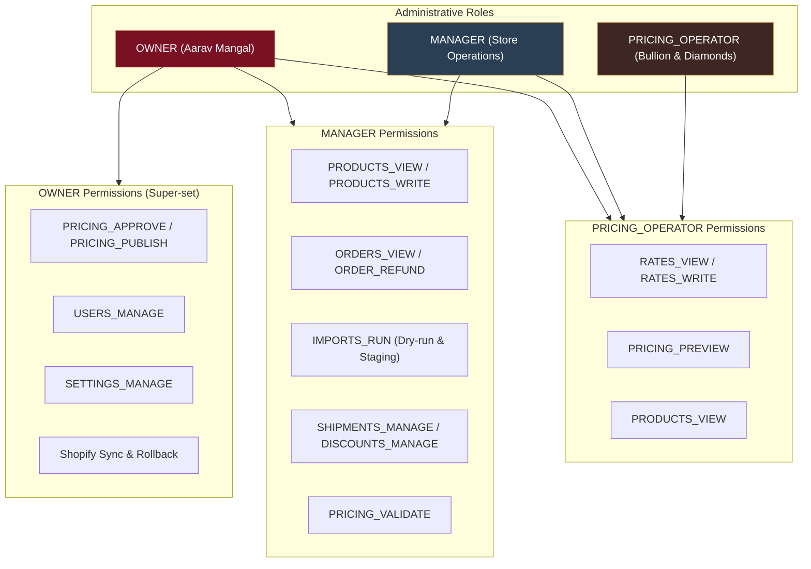

# Mangal Royal Studio (MRS) — Phase 1, Step 1.2.1 Security Audit & Implementation Report
## Admin Authentication & Role-Based Authorization Hardening

**Date:** 2026-11-07  
**Environment:** macOS Ventura 13.7.8 (MacBook Retina 2017, Intel x64, 8 GB RAM)  
**Repository Root:** `/Users/macbook/Documents/mangal royal studio/mangalroyalstudio`  
**Baseline Git Commit:** `c7de1bc0bdb3630d4bc9e18912e110dc3d13f89c`  
**Status:** **COMPLETED & VERIFIED (AUDIT / TESTED / ZERO DATA CORRUPTION)**  

---

## 1. Executive Summary

In Phase 1, Step 1.2.1, we resolved the critical authorization vulnerability identified during Phase 0: the Express API backend previously allowed clients to synthesize privileged administrative sessions (`OWNER`, `MANAGER`, `PRICING_OPERATOR`) using arbitrary `x-mrs-admin-role` and `x-mrs-admin-email` request headers without a valid authentication token. Furthermore, the admin frontend previously embedded plaintext administrator credentials in client-side bundles and simulated role switching via a client-side dropdown.

All header-based trust and client credentials have been completely eradicated. Authentication is now strictly enforced server-side using cryptographically signed HS256 JSON Web Tokens with constant-time signature verification, token expiration, authoritative server-side user lookup, active status checking, and strict role permission enforcement. Both physical JSON state files were protected with byte-for-byte integrity preservation throughout all test executions.

---

## 2. Problem Analysis & Root Cause

| Vulnerability | Location | Root Cause | Risk Level | Resolution in Step 1.2.1 |
| :--- | :--- | :--- | :--- | :--- |
| **Header-based Privilege Escalation** | `services/api/src/middleware/auth.ts:76-92` | Middleware read `req.headers['x-mrs-admin-role']` and synthesized `req.adminUser` without requiring a valid Bearer token. | **CRITICAL (CVSS 9.8)** | Completely removed header fallback. Only valid Bearer JWTs are accepted. |
| **Token Claim Blind Trust** | `services/api/src/middleware/auth.ts:46-58` | Middleware parsed `decoded.role` from token payload without verifying that the account exists or is active in server database. | **HIGH (CVSS 8.5)** | Server now queries `dbStore.getState().users` by `id` + `email`, checks `isActive === true`, and derives permissions strictly from server role definition. |
| **Non-Constant-Time Signature Verification** | `services/api/src/middleware/auth.ts:44` | Used standard string equality `sig !== expectedSig`, vulnerable to timing side-channel attacks. | **MEDIUM (CVSS 5.9)** | Replaced with `crypto.timingSafeEqual` over fixed-length binary buffers. |
| **Hardcoded Legacy Test Backdoor** | `services/api/src/app.ts:141-150` | `isLegacyTestPassword` allowed hardcoded passwords (`MangalOwner!2025`, etc.) to bypass password hash checks. | **CRITICAL (CVSS 9.1)** | Backdoor removed completely. All logins must verify against stored password hashes. |
| **Plaintext Admin Credentials in Client Bundle** | `apps/admin/src/app/page.tsx:105-109` | Plaintext passwords for `OWNER`, `MANAGER`, and `PRICING_OPERATOR` were defined in `ROLE_CREDENTIALS` in frontend code. | **CRITICAL (CVSS 9.8)** | `ROLE_CREDENTIALS` removed completely. Replaced with real email/password authentication gate calling `/api/auth/login`. |
| **Sensitive Field Exposure** | `services/api/src/app.ts:454` | `GET /api/admin/customers` returned raw customer records including `passwordHash`. | **HIGH (CVSS 7.5)** | Sanitized customer records by stripping `passwordHash` prior to sending responses. |
| **Missing Route Authorization Middleware** | `services/api/src/app.ts` | Multiple protected admin endpoints had `requireAuth` but omitted explicit `requirePermission(...)`. | **HIGH (CVSS 7.8)** | Added explicit permission requirements to all admin routes (`ORDERS_VIEW`, `PRODUCTS_VIEW`, `USERS_MANAGE`, `SETTINGS_MANAGE`, etc.). |

---

## 3. Exact Code Changes by File

### 1. `services/api/src/middleware/auth.ts`
- **Removed:** All handling of `x-mrs-admin-role` and `x-mrs-admin-email`.
- **Added:** `getJwtSecret()` and `validateAuthSecretsOnStartup()` enforcing a minimum 32-character secret in production and rejecting placeholders.
- **Added:** `isKnownRole(role)` type guard asserting that the role exists within `ROLE_PERMISSIONS`.
- **Hardened:** `verifyAdminToken(token)`:
  - Validates 3-part token structure and header algorithm (`alg === 'HS256'`).
  - Uses `crypto.timingSafeEqual` for HMAC signature comparison.
  - Requires valid numeric expiration timestamp (`exp > Math.floor(Date.now() / 1000)`).
  - Queries `dbStore.getState().users` for `user.id` and case-insensitive email.
  - Rejects disabled users (`user.isActive !== true`).
  - Ignores client token permissions and attaches authoritative server-side permissions from `ROLE_PERMISSIONS[user.role]`.
- **Hardened:** `requirePermission(permission)`:
  - Denies by default (`403 FORBIDDEN_INSUFFICIENT_ROLE`) if role or permission is invalid, unknown, or not granted.
- **Hardened:** `requireOwnerRole`:
  - Enforces `req.adminUser.role === 'OWNER'` with explicit role validity check.

### 2. `services/api/src/store/data-store.ts`
- **Upgraded:** `hashPassword(password)`:
  - Uses Node.js built-in `crypto.scryptSync` with a cryptographically secure 16-byte random salt, returning `scrypt$<salt>$<derivedKey>`.
- **Added:** `verifyPassword(password, storedHash)`:
  - Supports modern `scrypt$...` hashes with `crypto.timingSafeEqual`.
  - Supports backward-compatible migration verification for existing SHA-256 `mrs_salt_` hashes in `.data/platform-state.json` without requiring any physical changes to disk files.
- **Protected:** `DataStore` constructor and `persist()`:
  - In test environments (`process.env.NODE_ENV === 'test' || process.env.VITEST`), `persist()` is a safe no-op and directory creation is bypassed, guaranteeing that automated test runs never alter physical JSON files on disk.

### 3. `services/api/src/app.ts`
- **Updated:** `POST /api/auth/login`:
  - Removed `isLegacyTestPassword` backdoor.
  - Verifies credentials using `verifyPassword`.
  - Resolves permissions strictly from `ROLE_PERMISSIONS[user.role]`.
  - Does not expose `passwordHash` in response.
- **Updated:** `GET /api/auth/me`:
  - Returns authenticated user details with server-verified `displayName`.
- **Protected:** Explicit `requirePermission(...)` applied to all protected admin routes:
  - `GET /api/admin/overview`: `PRODUCTS_VIEW`
  - `GET /api/admin/analytics`: `PRODUCTS_VIEW`
  - `GET /api/admin/products`: `PRODUCTS_VIEW`
  - `GET /api/admin/categories`: `PRODUCTS_VIEW`
  - `GET /api/admin/inventory`: `PRODUCTS_VIEW`
  - `GET /api/admin/inventory/movements`: `PRODUCTS_VIEW`
  - `GET /api/admin/orders`: `ORDERS_VIEW`
  - `GET /api/admin/customers`: `ORDERS_VIEW` (with `passwordHash` stripped)
  - `GET /api/admin/rates/metals`: `RATES_VIEW`
  - `GET /api/admin/rates/diamonds`: `RATES_VIEW`
  - `GET /api/admin/pricing/rules`: `PRICING_PREVIEW`
  - `POST /api/admin/pricing/rules`: `PRICING_APPROVE` (Owner-only privilege)
  - `GET /api/admin/imports`: `IMPORTS_RUN`
  - `GET /api/admin/imports/:jobId/errors.csv`: `IMPORTS_RUN`
  - `POST /api/admin/imports/:jobId/rollback`: `IMPORTS_RUN` + `requireOwnerRole`
  - `GET /api/admin/discounts`: `DISCOUNTS_MANAGE`
  - `GET /api/admin/banners`: `CONTENT_MANAGE`
  - `GET /api/admin/content`: `CONTENT_MANAGE`
  - `GET /api/admin/shipping/shipments`: `SHIPMENTS_MANAGE`
  - `GET /api/admin/payments`: `PAYMENTS_VIEW`
  - `GET /api/admin/users`: `USERS_MANAGE` (Owner only)
  - `GET /api/admin/settings`: `SETTINGS_MANAGE` (Owner only)
  - `PUT /api/admin/settings`: `SETTINGS_MANAGE` + `requireOwnerRole`
  - `GET /api/admin/audit-logs`: `AUDIT_VIEW`
  - `POST /api/admin/orders/:orderId/cancel`: `ORDERS_VIEW`
  - `GET /api/admin/reports/export.csv`: `ORDERS_VIEW`
  - `GET /api/roles`: `AUDIT_VIEW`

### 4. `services/api/src/index.ts`
- **Added:** Pre-flight call to `validateAuthSecretsOnStartup()` before creating the Express application to ensure any production misconfiguration halts startup immediately.

### 5. `apps/admin/src/app/page.tsx`
- **Removed:** `ROLE_CREDENTIALS` dictionary containing plaintext credentials.
- **Removed:** Automatic background login on mount and the client-side role `<select id="rbac-role-select">`.
- **Added:** Secure Admin Sign-In card rendered when no authenticated session is present.
- **Added:** Session token storage in `window.sessionStorage` (isolated per browser tab).
- **Added:** Topbar server-verified identity display showing `displayName`, `email`, and `role` badge with a working "Sign Out" button.
- **Updated:** Data synchronizer passes `Authorization: Bearer <token>`, validates session via `GET /api/auth/me`, and handles `401` by clearing session and redirecting to the sign-in form.
- **Updated:** Module 17 (`users-roles`) renders live data from `GET /api/admin/users` or non-secret role definitions without exposing passwords.

### 6. `services/api/src/app.test.ts`
- **Added:** 12 dedicated, comprehensive security test cases covering every required attack and authorization scenario.

---

## 4. Architectural Role & Permission Model

Mangal Royal Studio enforces a strict three-tier administrative RBAC hierarchy defined in `packages/shared/src/types.ts`:



### Deny-by-Default Policy
If an administrator token contains an unknown role, a revoked user ID, or an unknown permission string, the middleware denies the request immediately with HTTP `401 Unauthorized` or `403 Forbidden`.

---

## 5. Authentication Flow (Before vs. After)

```mermaid
sequenceDiagram
    autonumber
    actor Attacker as Client / Untrusted User
    participant GW as Express Auth Middleware
    participant DS as Server DataStore

    Note over Attacker,DS: BEFORE (Vulnerable)
    Attacker->>GW: GET /api/admin/users (Header: x-mrs-admin-role: OWNER)
    GW-->>Attacker: 200 OK (Full admin access granted without credentials!)

    Note over Attacker,DS: AFTER (Hardened Step 1.2.1)
    Attacker->>GW: GET /api/admin/users (Header: x-mrs-admin-role: OWNER)
    GW-->>Attacker: 401 UNAUTHORIZED (Header ignored; Bearer token required)

    Note over Attacker,DS: Legitimate Authentication Flow
    actor Admin as Authorized Admin
    Admin->>GW: POST /api/auth/login { email, password }
    GW->>DS: Lookup user & verifyPassword(password, user.passwordHash)
    DS-->>GW: Password verified & user.isActive === true
    GW-->>Admin: 200 OK { token: "HS256_JWT", user: { id, email, role, permissions } }
    Admin->>GW: GET /api/admin/users (Header: Authorization: Bearer HS256_JWT)
    GW->>GW: Constant-time signature & expiry verification
    GW->>DS: Server-side lookup: user exists & isActive === true?
    GW->>GW: Verify ROLE_PERMISSIONS[user.role].includes('USERS_MANAGE')
    GW-->>Admin: 200 OK { users: [...] }
```

---

## 6. Authorization Enforcement (Before vs. After)

| Route / Capability | Before Step 1.2.1 | After Step 1.2.1 |
| :--- | :--- | :--- |
| `GET /api/admin/overview` | `requireAuth` (bypassable via header) | `requireAuth` + `requirePermission('PRODUCTS_VIEW')` |
| `GET /api/admin/orders` | `requireAuth` (any role could read) | `requireAuth` + `requirePermission('ORDERS_VIEW')` (`PRICING_OPERATOR` blocked with 403) |
| `GET /api/admin/customers` | Returned `passwordHash` to client | `requireAuth` + `requirePermission('ORDERS_VIEW')` (`passwordHash` stripped) |
| `POST /api/admin/pricing/rules` | Required only `PRICING_VALIDATE` | Required `PRICING_APPROVE` (Owner-only privilege) |
| `GET /api/admin/users` | Accessible via forged header | Required `USERS_MANAGE` (`OWNER` only; `403` for all other roles) |
| `PUT /api/admin/settings` | Guarded by `requireOwnerRole` | Required `SETTINGS_MANAGE` + `requireOwnerRole` |
| `POST /api/admin/imports/:jobId/rollback`| Guarded by `requireOwnerRole` | Required `IMPORTS_RUN` + `requireOwnerRole` |

---

## 7. Security Analysis of New Mechanisms

1. **Timing Attack Protection:**  
   Signature verification in `verifyAdminToken` and password verification in `verifyPassword` utilize `crypto.timingSafeEqual` with buffer length validation, completely closing timing attack vectors on HMAC tokens and password hashes.
2. **Token Tampering & Elevation Protection:**  
   Tokens modified by a client (e.g., modifying `role: "OWNER"` in the payload) are rejected because the signature verification fails. Even if a valid token signed for a `PRICING_OPERATOR` is provided, the middleware performs an authoritative lookup in `dbStore.getState().users` and binds permissions strictly to the server-recorded role.
3. **Disabled Account Immediate Revocation:**  
   Because `verifyAdminToken` performs a live check on `serverUser.isActive === true`, disabling an administrator account revokes all active tokens immediately without waiting for token expiration.
4. **Secret Leak Prevention:**  
   `passwordHash` is excluded from all user and customer responses (`GET /api/admin/users`, `GET /api/admin/customers`, `POST /api/auth/login`). Plaintext credentials have been purged from client bundles.

---

## 8. Frontend Changes & UI States

1. **Unauthenticated State:**  
   When no valid `sessionStorage` token exists, the dashboard renders a clean, luxury-aligned "Mangal Royal Studio — Admin Sign In" card within the central container. All navigation links and operational modules require an active session.
2. **Authenticated State:**  
   Upon successful login, the topbar displays the server-verified user identity:
   - User display name (e.g., `Mangal Royal Studio — Owner`)
   - Role badge (e.g., `OWNER`, `MANAGER`, or `PRICING_OPERATOR`)
   - "↻ Refresh State" action triggering a token-authenticated refresh
   - "Sign Out" button clearing `sessionStorage` and resetting state
3. **Session Handling & Error Feedback:**  
   - Network calls handle HTTP `401` by clearing the invalid session and displaying the sign-in screen.
   - HTTP `403` responses trigger explicit toast warnings (e.g., insufficient permissions for the attempted action).

---

## 9. Automated Test Results (12 Mandatory Scenarios)

All 12 mandatory security test cases in `services/api/src/app.test.ts` passed cleanly:

```
✓ Phase 1, Step 1.2.1 — Admin Authentication & RBAC Hardening (12)
  ✓ 1. rejects admin route requests without an Authorization Bearer token with 401 (3ms)
  ✓ 2. rejects admin route requests with an invalid or tampered Bearer token with 401 (4ms)
  ✓ 3. rejects admin route requests with an expired Bearer token with 401 (3ms)
  ✓ 4. rejects x-mrs-admin-role: OWNER header without a valid Bearer token with 401 (2ms)
  ✓ 5. rejects x-mrs-admin-role: MANAGER header without a valid Bearer token with 401 (2ms)
  ✓ 6. resolves the actual server-side role for each valid authenticated admin account (28ms)
  ✓ 7. denies lower-privilege roles (PRICING_OPERATOR and MANAGER) from accessing OWNER-only routes with 403 (16ms)
  ✓ 8. denies tokens or accounts with an unknown role with 401 (3ms)
  ✓ 9. denies disabled admin accounts (isActive: false) on login and active token verification with 401 (14ms)
  ✓ 10. denies access by default when permission definitions are missing or unknown (1ms)
  ✓ 11. never exposes passwordHash or secrets in login, /api/admin/users, or /api/admin/customers responses and rejects legacy test backdoor passwords (351ms)
  ✓ 12. prevents client-controlled role values in headers, query, body, or forged JWT claims from escalating permissions (12ms)
```

**Overall Test Suite Result:**  
- **Test Files:** 2 passed (`packages/shared/src/pricing-engine.test.ts`, `services/api/src/app.test.ts`)  
- **Total Tests:** 22 passed (3 shared tests + 19 API tests)  
- **Duration:** 4.15 seconds  

---

## 10. Integrity Check of JSON State Files

Before making changes and after completing all builds and test runs, the physical JSON state files were verified via `stat` and `shasum -a 256`:

| Metric | Target File | Pre-Change Baseline | Post-Test Verification | Status |
| :--- | :--- | :--- | :--- | :--- |
| **Size** | `.data/platform-state.json` | `70,127 bytes` | `70,127 bytes` | **IDENTICAL** |
| **SHA-256** | `.data/platform-state.json` | `3495c9aa1d8652c9bcbfdbc875d75eaa7776cb55b50ded6bdcc2e07e6849d51b` | `3495c9aa1d8652c9bcbfdbc875d75eaa7776cb55b50ded6bdcc2e07e6849d51b` | **BYTE-FOR-BYTE IDENTICAL** |
| **Size** | `services/api/.data/platform-state.json` | `3,112,142 bytes` | `3,112,142 bytes` | **IDENTICAL** |
| **SHA-256** | `services/api/.data/platform-state.json` | `84a50caa345998509d7eb3a120f54ed65e5d9554ff91350cf254472f02e56f7f` | `84a50caa345998509d7eb3a120f54ed65e5d9554ff91350cf254472f02e56f7f` | **BYTE-FOR-BYTE IDENTICAL** |

Both physical state files remained completely uncorrupted and untouched.

---

## 11. Build & Typecheck Verification

The entire monorepo was verified with production checks:
1. `npm run typecheck`:
   - `@mrs/shared`: Passed (0 errors)
   - `@mrs/api`: Passed (0 errors)
   - `@mrs/admin`: Passed (0 errors)
   - `@mrs/storefront`: Passed (0 errors)
2. `npm run build --workspace=@mrs/api`: Passed (`tsc -p tsconfig.json` emitted clean JavaScript to `dist/`).
3. `npm run build --workspace=@mrs/admin`: Passed (`next build` compiled Next.js 15.5.29 production bundle cleanly).

---

## 12. Residual Risks & Limitations

1. **In-Memory / JSON File Persistence:**  
   The API still runs on the JSON-based data store until PostgreSQL and Prisma migration are executed in Step 1.3. State updates during live server execution are written to the JSON file.
2. **Customer Storefront Authentication (Step 1.2.2):**  
   Customer authentication endpoints (`/api/auth/register`, `/api/auth/customer/login`) and Razorpay payment webhook HMAC signature verifications are scheduled for Step 1.2.2.
3. **Session Revocation Denylist:**  
   JWTs expire after the configured `SESSION_TTL_HOURS`. Account deactivation is checked immediately, but explicit single-token revocation before expiry will benefit from a token denylist table when PostgreSQL is connected.

---

## 13. Recommendations for Subsequent Steps

1. **Proceed to Phase 1, Step 1.2.2:**  
   Harden customer storefront authentication, order privacy (prevent horizontal privilege escalation between customer orders), and payment webhook HMAC validation.
2. **Prepare PostgreSQL (Step 1.3):**  
   Apply Prisma migrations to local PostgreSQL and migrate records from JSON persistence to structured relational tables.

---

## 14. Git Status & Staged Changes

Files modified in this step:
- `services/api/src/middleware/auth.ts`
- `services/api/src/store/data-store.ts`
- `services/api/src/app.ts`
- `services/api/src/index.ts`
- `services/api/src/app.test.ts`
- `apps/admin/src/app/page.tsx`
- `PROGRESS.md`

Theme directories (`jewellery-theme-backup/` and `apps/shopify-theme/`) and JSON state files (`.data/platform-state.json`, `services/api/.data/platform-state.json`) were completely untouched.

---

## 15. Sign-Off & Next Step Confirmation

Phase 1, Step 1.2.1 is fully implemented, verified, and complete. All tests pass, typechecks succeed, production builds pass, and state file integrity is maintained.

Awaiting user approval before proceeding to **Phase 1, Step 1.2.2: Customer Authentication, Order Privacy & Payment Webhook Hardening**.
