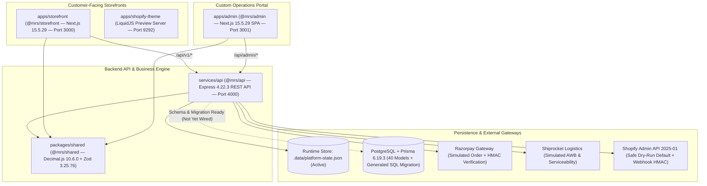

# Mangal Royal Studio — System Architecture (Code-Verified)

**Audit Reference:** [`CODE_VERIFICATION_AUDIT.md`](file:///c:/Users/manis/Videos/TCSC/sab%20saman/vs%20code%20projects/mangalroyalstudio/CODE_VERIFICATION_AUDIT.md)

---

## 1. High-Level Architecture Overview

Mangal Royal Studio is organized as a 4-workspace TypeScript monorepo alongside the original read-only Shopify theme backup (`jewellery-theme-backup/`) and working Liquid preview theme (`apps/shopify-theme/`):

---

## 2. Verified Workspace & Directory Structure

| Workspace / Path | Package Name | Default Port | Actual Source Files & Role | Status |
|---|---|---|---|---|
| [`packages/shared/`](file:///c:/Users/manis/Videos/TCSC/sab%20saman/vs%20code%20projects/mangalroyalstudio/packages/shared) | `@mrs/shared` | Library | [`pricing-engine.ts`](file:///c:/Users/manis/Videos/TCSC/sab%20saman/vs%20code%20projects/mangalroyalstudio/packages/shared/src/pricing-engine.ts), [`schemas.ts`](file:///c:/Users/manis/Videos/TCSC/sab%20saman/vs%20code%20projects/mangalroyalstudio/packages/shared/src/schemas.ts), [`types.ts`](file:///c:/Users/manis/Videos/TCSC/sab%20saman/vs%20code%20projects/mangalroyalstudio/packages/shared/src/types.ts), [`index.ts`](file:///c:/Users/manis/Videos/TCSC/sab%20saman/vs%20code%20projects/mangalroyalstudio/packages/shared/src/index.ts), [`pricing-engine.test.ts`](file:///c:/Users/manis/Videos/TCSC/sab%20saman/vs%20code%20projects/mangalroyalstudio/packages/shared/src/pricing-engine.test.ts) | `VERIFIED` |
| [`services/api/`](file:///c:/Users/manis/Videos/TCSC/sab%20saman/vs%20code%20projects/mangalroyalstudio/services/api) | `@mrs/api` | `4000` | [`app.ts`](file:///c:/Users/manis/Videos/TCSC/sab%20saman/vs%20code%20projects/mangalroyalstudio/services/api/src/app.ts), [`index.ts`](file:///c:/Users/manis/Videos/TCSC/sab%20saman/vs%20code%20projects/mangalroyalstudio/services/api/src/index.ts), [`middleware/auth.ts`](file:///c:/Users/manis/Videos/TCSC/sab%20saman/vs%20code%20projects/mangalroyalstudio/services/api/src/middleware/auth.ts), [`store/data-store.ts`](file:///c:/Users/manis/Videos/TCSC/sab%20saman/vs%20code%20projects/mangalroyalstudio/services/api/src/store/data-store.ts), [`services/excel-importer.ts`](file:///c:/Users/manis/Videos/TCSC/sab%20saman/vs%20code%20projects/mangalroyalstudio/services/api/src/services/excel-importer.ts), [`services/shopify-service.ts`](file:///c:/Users/manis/Videos/TCSC/sab%20saman/vs%20code%20projects/mangalroyalstudio/services/api/src/services/shopify-service.ts), [`services/shiprocket-service.ts`](file:///c:/Users/manis/Videos/TCSC/sab%20saman/vs%20code%20projects/mangalroyalstudio/services/api/src/services/shiprocket-service.ts), [`scripts/generate-sample-excel.ts`](file:///c:/Users/manis/Videos/TCSC/sab%20saman/vs%20code%20projects/mangalroyalstudio/services/api/src/scripts/generate-sample-excel.ts), [`scripts/storefront-preview-server.ts`](file:///c:/Users/manis/Videos/TCSC/sab%20saman/vs%20code%20projects/mangalroyalstudio/services/api/src/scripts/storefront-preview-server.ts) | `VERIFIED` |
| [`apps/storefront/`](file:///c:/Users/manis/Videos/TCSC/sab%20saman/vs%20code%20projects/mangalroyalstudio/apps/storefront) | `@mrs/storefront` | `3000` | Next.js 15 App Router customer storefront (19 routes) | `VERIFIED` |
| [`apps/admin/`](file:///c:/Users/manis/Videos/TCSC/sab%20saman/vs%20code%20projects/mangalroyalstudio/apps/admin) | `@mrs/admin` | `3001` | Next.js 15 Admin Dashboard single-page console ([`src/app/page.tsx`](file:///c:/Users/manis/Videos/TCSC/sab%20saman/vs%20code%20projects/mangalroyalstudio/apps/admin/src/app/page.tsx)) | `VERIFIED` |
| [`apps/shopify-theme/`](file:///c:/Users/manis/Videos/TCSC/sab%20saman/vs%20code%20projects/mangalroyalstudio/apps/shopify-theme) | N/A | `9292` | Working Shopify Dawn 15.5.0 Liquid theme (382 files) served locally by `storefront-preview-server.ts` | `VERIFIED` |
| [`jewellery-theme-backup/`](file:///c:/Users/manis/Videos/TCSC/sab%20saman/vs%20code%20projects/mangalroyalstudio/jewellery-theme-backup) | N/A | Read-Only | Original Shopify Dawn 15.5.0 backup (**378 files** including `AGENTS.md`, 100% untouched) | `VERIFIED` |

---

## 3. Verified Technology Versions

- **Node.js Runtime & TypeScript:** TypeScript `5.9.3` (`strict: true`)
- **Frontend Framework:** Next.js `15.5.29` + React `19.3.1`
- **Backend Framework:** Express `4.22.3` + Multer `1.4.5-lts.1` + CORS `2.8.5`
- **Pricing & Validation:** `decimal.js` `10.6.0` + `zod` `3.25.76`
- **Excel Processing:** SheetJS `xlsx` `0.18.5`
- **Database ORM:** Prisma `6.19.3` (`@prisma/client` `6.19.3`)
- **Testing:** Vitest `2.1.9`
